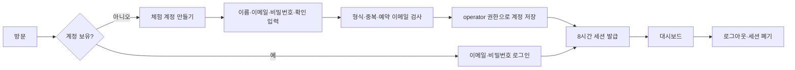

# 계정 생성과 로그인

## 사용자 흐름

1. 로그인 화면에서 **체험 계정 만들기**를 선택한다.
2. 이름 2~60자, 이메일, 비밀번호와 확인값을 입력한다. 비밀번호는 8~128자이고 영문과 숫자를 포함해야 한다.
3. 이름 공백을 정리하고 이메일을 trim·소문자 정규화한다. 중복 이메일, 관리자 예약 주소, 확인 불일치를 거부한다.
4. 가입 성공 시 일반 사용자(operator)로 저장하고 바로 로그인한다. 메일 발송·인증은 이 체험 흐름에 포함하지 않는다.
5. 로그아웃한 뒤 같은 이메일과 비밀번호로 재로그인한다. 세션은 8시간 후 만료된다.

## 권한

| 작업 | 일반 사용자 / 체험 운영자 | 관리자 |
|---|---|---|
| 대시보드·설비·데이터·실험 결과 조회·CSV | 가능 | 가능 |
| 샘플 수집·시뮬레이션·통계 모델 학습 | 가능 | 가능 |
| 생산 작업지시·가상 로봇 작업·합성 데이터 생성 | 가능 | 가능 |
| 커넥터 추가·모델 배포·제안 승인/반려 | 불가 | 가능 |
| 사용자 목록·감사로그 조회 | 불가 | 가능 |

가입 요청에 `role` 같은 추가 필드를 보내면 거부한다. 신규 가입자의 역할은 서버 및 체험 어댑터에서 operator로 고정한다. 관리자 페이지의 사용자 목록은 이름·이메일·역할만 반환하며 비밀번호 해시를 노출하지 않는다.

## 관리자 설정과 기존 설치 갱신

관리자 이메일은 `admin@admin.com`이다. 실제 서버 암호는 무시되는 로컬 `.env`의 `ADMIN_PASSWORD`로 설정한다. 암호 원문을 저장소·README·JS 번들·테스트 코드에 넣지 않는다. 공개 Pages 체험은 별도 PBKDF2 검증값을 사용한다. 새 설치에서는 `.env.example`을 복사하고 원하는 실제 서버 암호를 설정해야 한다.

API 시작 시 `id=admin` 계정을 현재 ADMIN_EMAIL / ADMIN_PASSWORD에 맞춰 갱신한다. 설정이 변경된 경우 기존 관리자 세션을 폐기하며, 설비·이벤트·작업·다른 사용자 데이터는 보존한다. 설정이 동일하면 기존 세션을 유지한다. 새 버전은 공유 운영자/조회자 데모 계정을 자동 생성하지 않는다. 이전 설치에서 생성된 계정은 기존 데이터로 보존된다.

## Pages와 서버 연결 모드

| 항목 | GitHub Pages | 실제 백엔드 |
|---|---|---|
| 사용자 저장 | 현재 브라우저 localStorage | PostgreSQL (로컬 개발은 SQLite) |
| 비밀번호 | 무작위 salt + PBKDF2-SHA256 600,000회 | 무작위 salt + PBKDF2-SHA256 600,000회 |
| 세션 | 탭별 sessionStorage, 8시간 | DB의 해시 bearer 토큰, 8시간 |
| 다른 브라우저·기기 로그인 | 계정이 공유되지 않음, 별도 가입 | 같은 서버이면 가능 |
| 인증의 의미 | UI 체험용 상태, 보안 경계가 아님 | 서버가 인증·권한 검사 |
| 가입 제어 | 공개 체험에서 제공 | ALLOW_REGISTRATION |

기존의 자동 관리자 진입은 제거했다. 이전 버전의 자동 진입 토큰으로 새 인증에 접근할 수 없다. Pages에서 사이트 데이터를 삭제하면 그 브라우저에 만든 계정도 삭제된다. 실제 서비스의 계정 공유와 접근 통제는 서버 연결 모드를 사용해야 한다.

기존 scrypt 비밀번호는 계속 검증할 수 있으며, 새로 만든 계정과 변경된 관리자 암호에는 PBKDF2를 사용한다. 검증 오류에는 제출한 암호를 다시 포함하지 않는다. 구현 참조: [Web Crypto PBKDF2](https://developer.mozilla.org/en-US/docs/Web/API/Pbkdf2Params).

`ALLOW_REGISTRATION=false`이면 서버의 가입 API가 403을 반환하고 로그인 화면에서 가입 탭을 숨긴다. API 단독 실행 시 미지정 기본값은 DEMO_MODE=true에서만 허용이며, Compose 예제는 체험을 위해 명시적으로 true를 설정한다.

메일 인증·암호 찾기·외부 SSO·관리자에 의한 권한 변경/계정 삭제 UI는 이번 가입 흐름에 포함하지 않는다.
