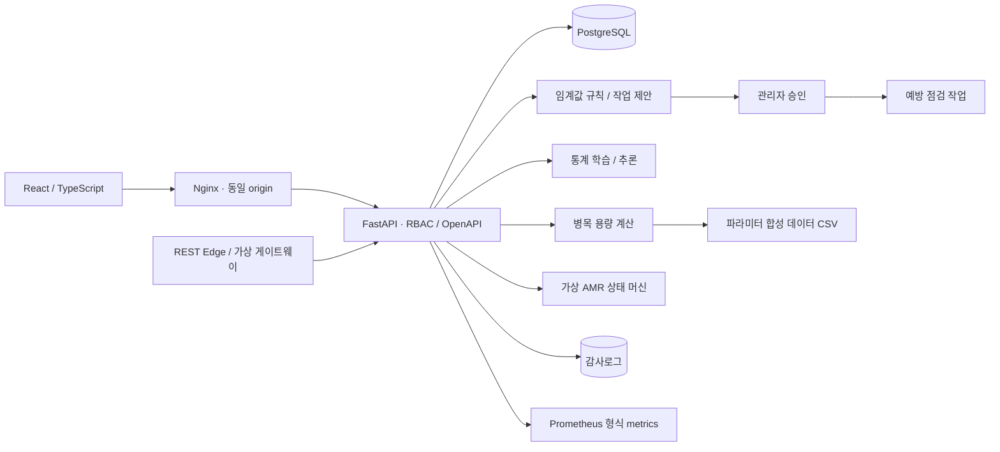

# 시스템 아키텍처

## 실행 모드

| 모드 | 데이터·권한 | 실행 위치 |
|---|---|---|
| GitHub Pages 공개 체험 | localStorage의 합성 데이터·가입 계정, 명시적 로그인, 인증 보안 경계 없음 | 방문자 브라우저 |
| 로컬 빠른 시작 | SQLite + FastAPI 세션/RBAC + 가상 스트림 | 개발 머신 |
| Docker 기업형 MVP | PostgreSQL + FastAPI 세션/RBAC + Nginx | Docker Compose |

Pages 빌드에만 `VITE_STATIC_DEMO=true`를 주입한다. 서버 빌드는 네트워크 실패 시 체험 데이터로 대체하지 않는다. 공개 데모에 실제 데이터를 넣지 않는다. 상태는 브라우저·origin별로 독립적이며 사이트 데이터를 지우면 초기화된다.

## 핵심 경로

## 백엔드 컴포넌트

| 컴포넌트 | 상태 | 목적 |
|---|---|---|
| FastAPI / Pydantic | 동작 | typed API, 범위 검증, OpenAPI |
| SQLAlchemy + psycopg | 동작 | PostgreSQL/SQLite DB 접근, 트랜잭션 |
| Alembic | 동작 | 명시적 001_initial migration |
| PostgreSQL 16 | Compose 핵심 | 영속 업무 데이터, 잠금·유일키 |
| Nginx | Compose 핵심 | 정적 콘솔 및 API reverse proxy |
| PBKDF2 + opaque sessions | 동작 | 신규 PBKDF2 해시·기존 scrypt 검증·8시간 세션·RBAC |
| Prometheus client | 동작 | 요청 수, 지연 히스토그램; 관리자 토큰 필요 |
| Redis 7 | 선택 프로필 | 미래 캐시·작업 큐 기반; 현재 미연결 |
| Eclipse Mosquitto 2 | 선택 프로필 | 미래 MQTT gateway 기반; 현재 미연결 |
| S3/MinIO | 설계 | 모델 아티팩트·대규모 데이터 저장; 미구현 |
| Keycloak / Entra ID | 설계 | OIDC SSO·MFA; 미구현 |
| MLflow / Celery / OTEL | 설계 | 학습 실험·비동기 작업·분산 추적; 미구현 |

OT 수집 프로토콜 어댑터와 실로봇 제어는 구현하지 않았다. UI의 MQTT/OPC-UA/Modbus 커넥터는 설정 리소스이며 실제 연결로 표시하지 않는다.

## 저장 모델

`users` → `login_sessions`; `assets` → `telemetry`; `resources`; `audit_logs`.

이벤트는 (source,event_id) 유일키와 asset FK를 갖는다. 시간은 UTC ISO 문자열로 정규화한다. 사업장 규모가 커지면 timestamp를 native timestamptz로 전환하고 (asset_id,timestamp) 복합 인덱스·기간 파티션을 추가한다.

`resources`의 JSON은 실험/모델/작업 메타데이터를 유연하게 저장하기 위한 MVP 선택이다. JSON 내부 ID는 FK가 아니므로 서비스에서 검증한다. 제품화 시 모델·작업·승인 테이블을 분리하고 DB 수준의 참조·상태 제약을 강화한다.

## 트랜잭션과 실행 통제

- 수집 배치는 같은 DB 트랜잭션에서 유효성, 이벤트 저장, 수량 반영, 알림·제안 생성을 수행한다. 오류가 발생하면 전체 롤백한다.
- 설비를 ID 순으로 `SELECT FOR UPDATE`해 수집 순서를 직렬화한다. 이벤트 유일키 충돌은 409이며 같은 ID로 재시도 가능하다.
- 지연 이벤트는 카운터와 이력에 반영하되 최신 센서값을 교체하지 않는다.
- 승인: `UPDATE ... WHERE status='pending'`의 행 수가 1일 때만 점검 작업 생성. 중복 요청 409.
- 로봇 배정: 로봇 리소스 잠금, idle/배터리 검사. 완료는 running 조건부 갱신 후 상태·위치·배터리 갱신.
- 라인 시작: 라인의 설비를 잠근 뒤 활성 작업이 없는지 검사. 한 라인에 한 활성 작업.
- 모델 배포: 설비 잠금 뒤 같은 설비·지표의 이전 배포를 archived로 변경.
- SQLite의 `FOR UPDATE`는 행 잠금을 제공하지 않는다. 병렬 운영은 PostgreSQL 모드를 사용한다.

## 운영 제약과 확장

기본 데모 스트림은 API 프로세스 내부에서 8초 간격으로 8개 설비의 합성 이벤트를 만든다. 브라우저는 6초마다 overview를 읽는다. WebSocket/진짜 스트리밍 SLA를 주장하지 않는다. 다중 API worker는 DEMO_STREAM=false로 설정하고 별도 수집 프로세스를 사용한다.

현재 리소스 목록은 최근 200개, 이벤트 화면 100개, CSV 10,000개로 제한한다. 보존 정책, 일괄 export, pagination, 알림 dedup window, 재학습 기준, 사용자 관리, 로그인 rate limit, DB 백업, 비밀 관리, 외부 감사 저장은 파일럿 요구사항이다.

Compose는 `127.0.0.1:8088`만 호스트로 노출한다. 선택 MQTT는 Docker 내부에서만 익명 접근 가능하며 현장 네트워크에 노출하기 전 인증과 TLS를 구성해야 한다. TLS와 백업은 배포 환경에서 구성한다.

## 계정 흐름 확장

자가 가입 → operator 고정 → 자동 세션 발급을 추가했다. 관리자만 GET /api/users를 조회한다. 가입·로그인 감사 기록과 관리자 설정 변경 시 세션 폐기를 지원한다. 테이블 구조는 그대로 사용하므로 추가 migration이 필요하지 않다. [계정 가이드](ACCOUNTS.md)를 참고한다.
