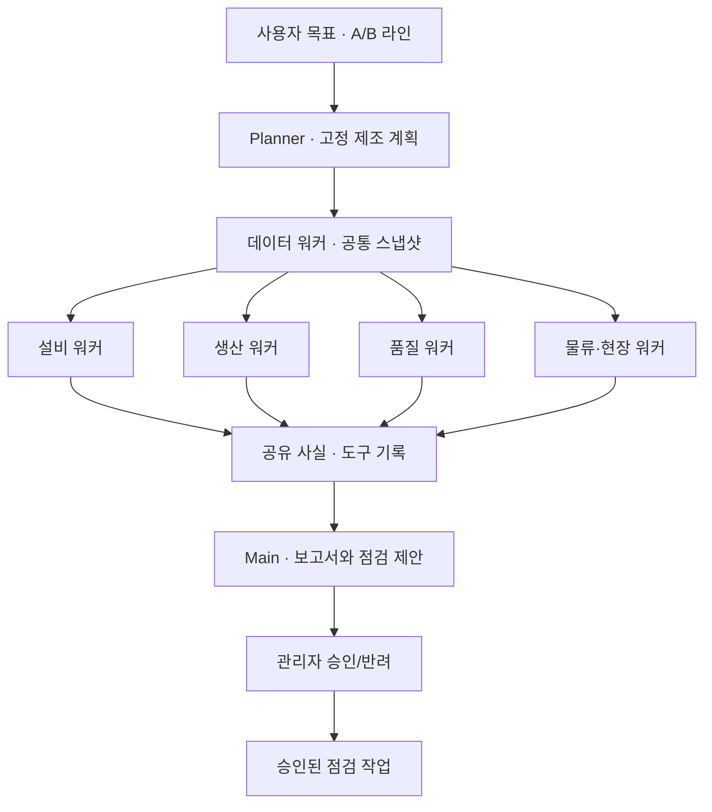

# 제조 멀티 에이전트 플랫폼

[ARTEX 공개 아키텍처](https://github.com/Aa-creat/artex/blob/main/README.en.md)의 목표 → Planner → 전문 Worker → Main Agent, 공유 상태, 자산 그래프/실행 그래프, 승인 게이트 개념을 참고했다. ARTEX 코드를 포함하지 않은 독립 구현이며 제조 진단 도구만 실행한다.



## 구현 계약

- **Planner**는 실행 생성 시 목표·라인·분석 엔진과 데이터 스냅샷을 고정하고 선택 모듈과 의존성을 포함해 DAG를 구성한다(라면 기본 23개 노드). 자유로운 임의 도구 생성은 하지 않는다.
- **20개 독립 모듈**: 데이터·설비·생산·품질·물류·엣지·트윈·시뮬레이션·AI 모델·로봇·피지컬 AI·패널·CCTV·인벤토리·분류·창고·LOT·BOM·제면·스프. 선행 의존성이 완료된 워커들을 관리자 설정(동시 1~4개)에 따라 실행한다. [개발·구성·수정 가이드](AGENT-MODULES.md)에 파일 경계와 계약을 정의한다.
- **이중 그래프**: 실행 DAG는 의존성·상태·실행 시간, 자산 그래프는 선택 라인의 설비·작업·패널·카메라 연결을 보여 준다.
- **공유 블랙보드**에는 실제 계산 수치, 근거 ID, 요약을 저장한다. 도구 기록은 입출력 요약과 시간·엔진, 제공자가 반환한 토큰 수를 기록한다. 원시 사고 과정은 저장/노출하지 않는다.
- **Main**은 워커 결과를 합쳐 보고서를 생성하고 임계값 초과 설비의 기존 pending 제안을 재사용하거나 새 점검 제안을 만든다. 관리자가 승인해야 점검 작업이 생성된다. PLC·로봇 제어는 실행하지 않는다.
- **실행 제어**: queued/running → paused → queued, 또는 cancelled. 세대 번호로 중지 이전 워커의 늦은 결과를 폐기한다. 이미 전송한 LLM HTTP 요청 자체를 취소하지는 않는다. API 재시작 시 진행 실행은 paused로 복구한다.

현재 백엔드는 FastAPI BackgroundTasks + ThreadPoolExecutor + DB 상태의 단일 프로세스 MVP다. 내구성 있는 분산 큐나 다중 인스턴스 스케줄러는 아니다. 확장 시 작업 큐·분산 잠금·재시도 정책을 분리해야 한다. Pages는 브라우저 내 순차 계산으로 같은 화면·상태 계약을 체험하며 서버 병렬 실행을 제공하지 않는다.

## LLM 연결

기본 **제조 도구 에이전트** 모드는 실제 제조 데이터에 결정론적 도구를 적용하며 LLM을 호출하지 않는다. 선택적인 **로컬 LLM + 제조 도구**는 Ollama의 `/api/chat`에 각 도구의 결과만 전달해 구조화된 요약을 받는다. 자산 접근 키나 카메라 URL은 전달하지 않는다. LLM이 임의의 도구나 점검 대상을 결정하지 않는다.

API 실행 환경에 다음 값을 설정한 뒤 재시작한다.

```dotenv
LLM_BASE_URL=http://host.docker.internal:11434
LLM_MODEL=<Ollama에 설치한 모델명>
```

호스트에서 직접 API를 실행하면 BASE_URL을 `http://127.0.0.1:11434`로 설정한다. 모델 설치와 Ollama 서비스 실행은 별도다. 관리자는 실행 엔진에서 로컬 LLM을 선택할 수 있다. 미설정 상태는 UI에서 비활성화하고 API는 409, 연계 실패는 failed로 기록한다. 도구 모드로 조용히 대체하지 않는다. 현재 실제 모델은 연결하지 않았으며 HTTP 계약·토큰 기록·실패 처리는 모의 Ollama 응답으로 자동 검증했다. [Ollama 공식 API](https://docs.ollama.com/api/chat)를 따른다.

기능별 에이전트 탭에서 개별 기준·의존성·사용 여부·요약 지침·리비전을 관리한다. 기존 5개 워커의 저장 이력도 계속 조회할 수 있다. 위 개념도는 역할 개요이며 현재 실제 DAG는 선택한 카탈로그 의존성으로 생성한다.

## 업종 공용 모듈 확장

기본 20개 모듈 중 공용은 18개, 라면 전용은 제면/스프 2개다. 일반 제조 프로필에서는 전용 모듈을 제외하고 Planner DAG를 구성한다. 공급망 자산은 라인 소속을 임의 부여하지 않고 SUPPLY-SHARED 노드에 연결한다. 기존 실행은 생성 시점 업종·원장·코드 버전·리비전을 고정한다. 대시보드와 현장 위젯은 같은 도구를 읽기 전용으로 실행하며 LLM 호출·승인 작업을 만들지 않는다.
